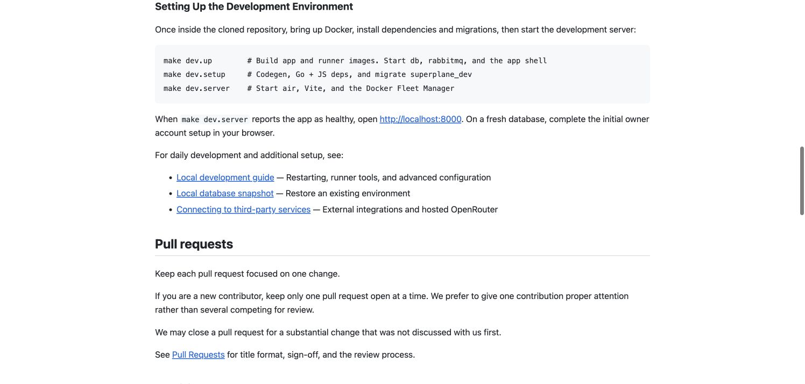
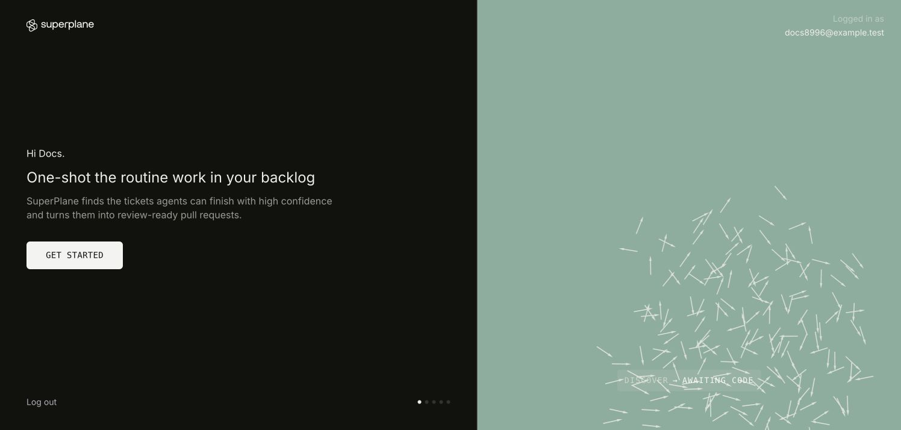

# Contributor Quickstart Evidence

Validation for [PR #5](https://github.com/velrino/superplane/pull/5).
See [the validation record](validation.txt) for the environment and checks.

## Rendered Quickstart

The preview uses the Markdown from documentation commit `e9f59058f`.

## Fresh Owner Setup

A disposable local owner reaches workspace onboarding after installation setup.
The test skips optional SMTP and fleet configuration.

