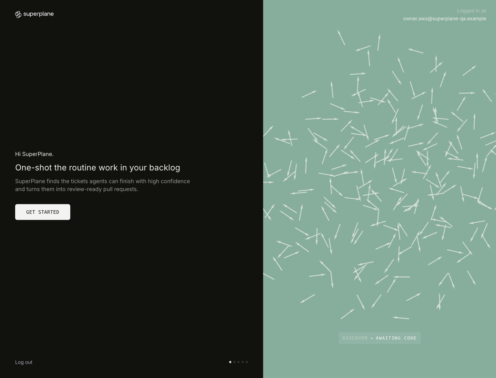
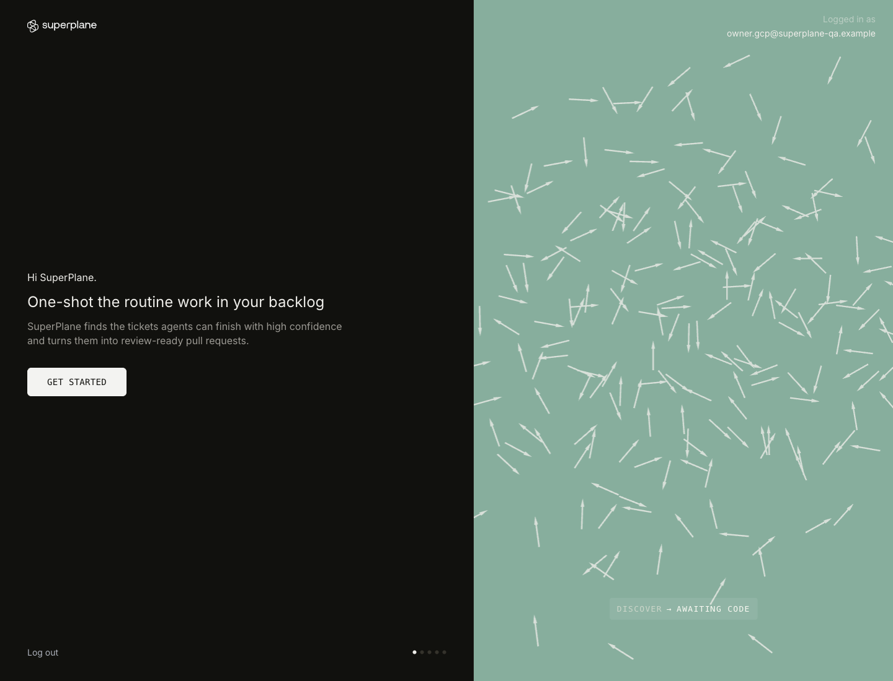
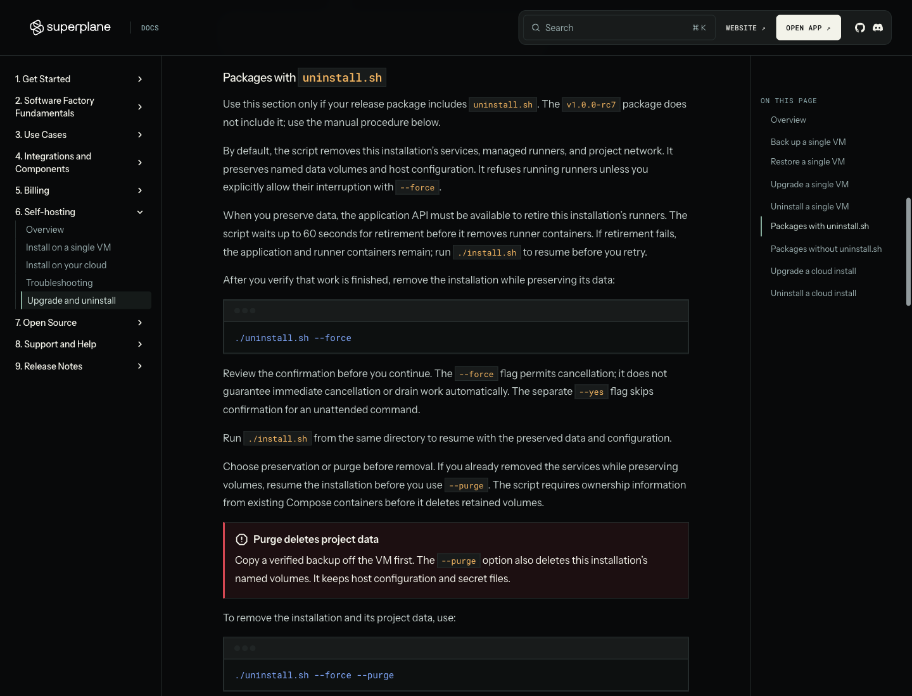

# Single-VM lifecycle review evidence

This set supports review of installation, preserving removal, resumption, and purge on temporary AWS and GCP VMs.
The observations were collected on October 26, 2026. Both cloud environments were removed and their cleanup was verified.

The candidate lifecycle scripts used published SuperPlane `v1.0.0-rc7`, Fleet Manager `v0.1.6-docker`, and Runner `v0.2.1` images.
This was a local candidate test, not a new official release or an application binary built from main.

## Reproduced problem and final results

| Evidence | Result | Format |
| --- | --- | --- |
| [Published uninstall](logs/aws-published-uninstall.log) and [remaining resources](reports/published-uninstall.json) | The documented Compose command returned zero but left one running managed runner and its network. | Original raw log and selected-field summary |
| [AWS final v5 runtime](reports/aws-v5-runtime.json) and [completion excerpt](logs/aws-v5-result-excerpt.txt) | Package, pipeline contract, and runtime smoke checks passed. Runner diagnostics checked actual Docker containers. | Selected-field summary and unmodified log excerpts |
| [GCP preserve, resume, and purge](reports/gcp-lifecycle.json) | Seven volumes survived preserving removal. Resumption restored one physical runner and retained the owner and workspace. | Selected-field summary |
| [GCP final inventory](logs/gcp-after-purge.log) and [repeat purge](logs/gcp-repeat-purge.log) | No containers, project networks, or project volumes remained. Repeated removal made no changes. | Original raw logs |
| [Cloud cleanup](reports/cloud-cleanup.json) | AWS and GCP reported complete cleanup with no remaining task resources. | Selected-field summary |

The AWS smoke used a local test endpoint without certificate verification. The GCP resume check used public HTTPS with normal certificate verification.
Purge retained host configuration and original signing keys as documented. Cloud VM and disk deletion removed those remaining host files.

## Screenshots

These original, unchanged PNGs are 1440 × 1100 pixels. Select an image to inspect it at full resolution.
The application images show the existing rc7 interface. They do not represent UI changes in this proposal.
The visible owner email addresses are synthetic accounts under the reserved `.example` domain.

### AWS: authenticated session after preserving removal and resume

This v4 capture shows session and workspace persistence. It does not prove runner recovery.
V4 left stale runner records. The later v5 runtime tests and GCP validation demonstrate the corrected recovery.

### GCP: authenticated session after resume with the final lifecycle scripts

This capture shows the same authenticated owner after preserving removal and resume.
The accompanying GCP report verifies one running Docker runner, matching API capacity, and unchanged configuration fingerprints.

### Documentation: preserve or purge, with runner retirement guidance

This local, unpublished preview explains API-based runner retirement, the cancellation deadline, recovery, and purge behavior.
It is the final v2 capture of this documentation section.

## Provenance and limits

[provenance.json](provenance.json) identifies each source, transformation, and original hash.
[SHA256SUMS.txt](SHA256SUMS.txt) covers the publication files.
[review-checks.json](review-checks.json) records the limited publication checks and earlier source scans.

Reports are summaries, not full raw diagnostics. They omit cloud identifiers, configuration contents, private files, and unrelated logs.
Only the three files labeled as original raw logs are complete unchanged logs. The AWS v5 completion file contains selected unchanged lines.

This set covers the single-VM Docker Compose flow on amd64.
It does not establish ARM, Terraform/Kubernetes, backup restoration, cross-version upgrades, production sizing, or hosted Semaphore execution.
The checks reduce publication risk within this selected set; they do not prove that every possible secret is absent.
